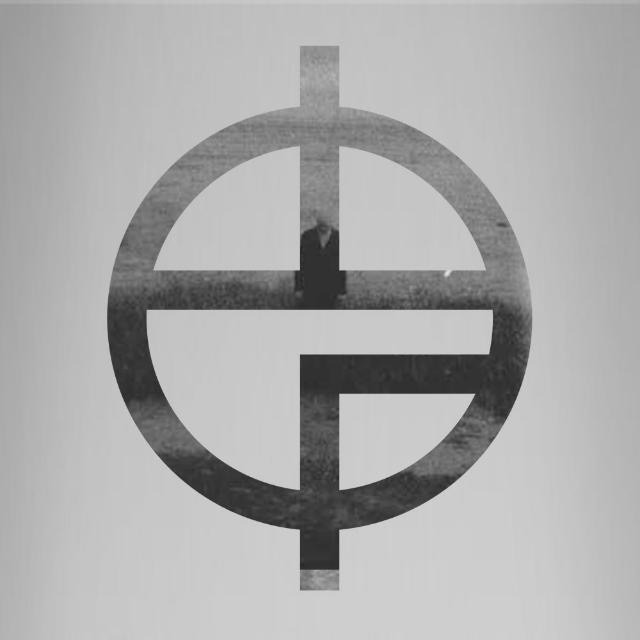

<p align="center">
  
</p>

<h1 align="center">MetroGuty</h1>

<p align="center">
  <strong>Motor rítmico de precisão para macOS</strong><br/>
  Um metrônomo nativo, feito em SwiftUI, que mora na janela <em>e</em> na barra de menus.
</p>

<p align="center">
  
  
  
  
</p>

---

## ✨ Por que o MetroGuty?

A maioria dos metrônomos agenda os cliques com timers, e timers atrasam. O MetroGuty roda o
sequenciador **dentro do callback de render do áudio** (AVFoundation), então cada clique cai
**no sample exato**. Nada de tempo "escorregando" em sessões longas.

## 🎛️ Recursos

| | |
|---|---|
| 🎯 **Precisão de sample** | Sequenciador no render callback, sem jitter de timer |
| 🎚️ **10 a 300 BPM** | Com indicação de andamento (Grave, Largo, Adagio… Prestissimo) |
| 👆 **Tap Tempo** | Bata no ritmo e o BPM se ajusta sozinho |
| 🔊 **12 timbres reais** | Digital 1–3, Cowbell, Mecânico 1–3, Conga, Woodblock, Claves, Baquetas, Hi-Hat |
| 🥁 **16 subdivisões** | Colcheia, tercina, semicolcheia, shuffle, contratempo, quintoletos, septoletos, swing… |
| 💥 **Acento no 1º tempo** | E fórmula de compasso configurável |
| 🚀 **Speed Training** | Sobe o BPM automaticamente: início → fim, passo e intervalo configuráveis |
| 🤫 **Compassos silenciosos** | Toca X compassos e silencia Y (fixo ou aleatório) pra treinar o tempo interno |
| 💾 **4 presets** | Salve BPM, compasso, timbre, subdivisão e volume em P1–P4 |
| ⚡ **Flash visual** | Pisca a cada tempo |
| ⏱️ **Cronômetro** | Quanto tempo você estudou |
| 📌 **Barra de menus** | Versão compacta sempre à mão. Fechar a janela não encerra o app |

## ⌨️ Atalhos

| Tecla | Ação |
|---|---|
| `Espaço` | Iniciar / Pausar |
| `↑` / `↓` | Aumentar / Diminuir BPM |
| `T` | Tap Tempo |
| `⌘ .` | Parar e zerar |

## 🛠️ Compilando

Requisitos: **macOS 14+** e **Xcode 15+** (ou as Command Line Tools com Swift 5.9).

Rodar direto em modo dev:

```bash
swift run
```

Gerar o `.app` universal (Apple Silicon + Intel), com ícone, e o `.dmg` pra distribuir:

```bash
./build_app.sh
```

O resultado fica em:

- `build/MetroGuty.app`
- `build/MetroGuty.dmg` (é só arrastar pra pasta Aplicativos)

> O app é assinado ad-hoc. Na primeira abertura o macOS pode reclamar; nesse caso clique com o
> botão direito → **Abrir**.

## 🗂️ Estrutura

```
MetroGuty/
├── Package.swift
├── build_app.sh              # build universal + .app + ícone + .dmg
├── scripts/make_icon.swift   # gera o ícone squircle a partir do logo
├── Resources/
│   ├── logo.jpg
│   └── mp3/                  # timbres (downbeat / beats / div)
└── Sources/MetroGuty/
    ├── MetroGutyApp.swift    # entry point, menus e atalhos
    ├── AudioEngine.swift     # motor de áudio com precisão de sample
    ├── MetronomeModel.swift  # estado, speed training, presets
    ├── Catalog.swift         # timbres, subdivisões e andamentos
    ├── ContentView.swift     # janela principal
    ├── MenuBarPanel.swift    # painel da barra de menus
    ├── Components.swift      # componentes de UI
    ├── Theme.swift           # cores e estilo
    └── Icons.swift
```

---

<p align="center">Feito com 🥁 por <a href="https://github.com/Hundily">Hundily Cerqueira</a></p>
